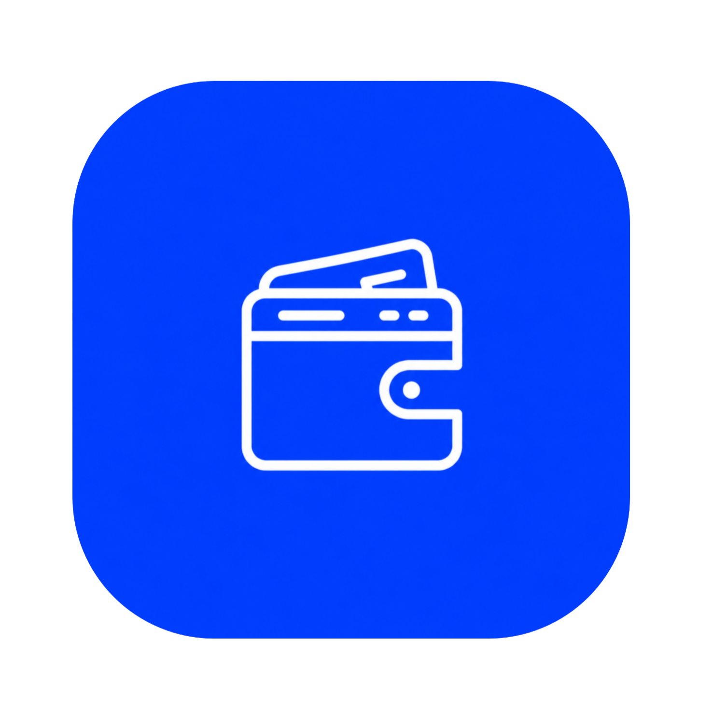
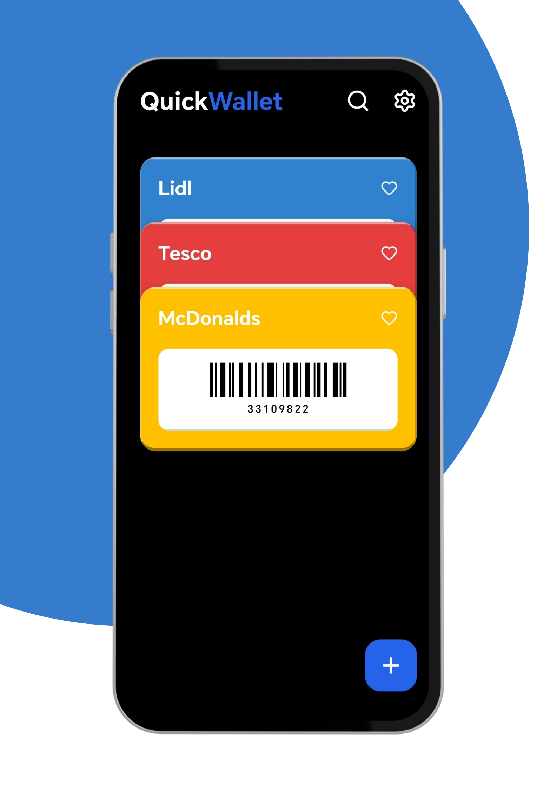
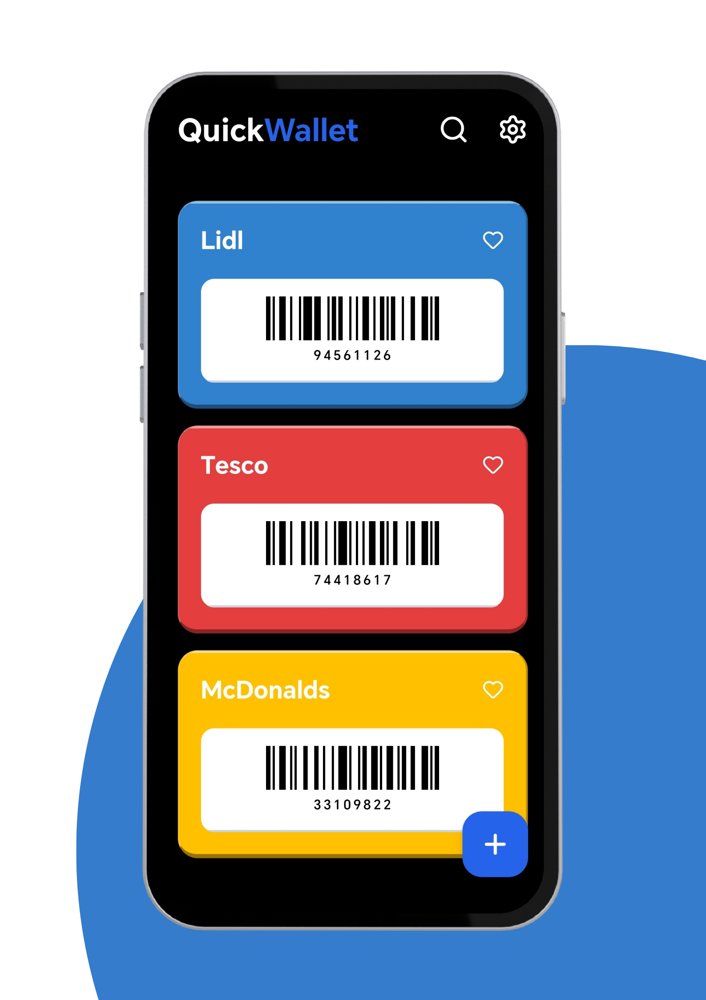
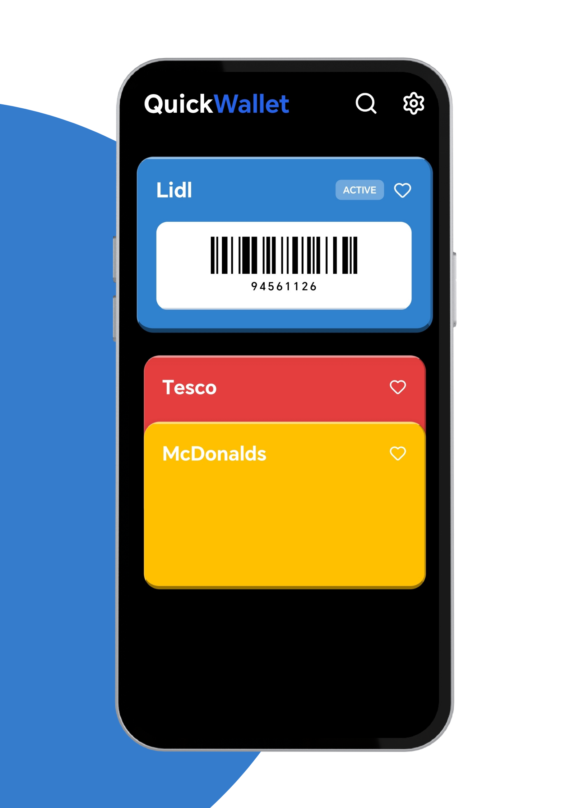

 

  
   
  

<h1 align="center" style="border-bottom: none;">QuickWallet</h1>

  <strong>A clean, secure home for all your loyalty cards.</strong>

  Offline-first. Private. Simple.

  Built with Expo / React Native.

## Features

### Card Management

- **Easy card addition** — scan a barcode or QR code using your camera, or import an image directly from your gallery.
- **Wide format support** — EAN-13, EAN-8, CODE128, CODE39, UPC-A, UPC-E, PDF417, Aztec, and QR codes.
- **Custom appearance** — personalize every card with your own color.
- **Favorites** — keep your most frequently used cards within easy reach.
- **Instant search** — quickly find any card by name.
- **Drag & drop reordering** — organize your wallet exactly the way you want.

### Everyday Experience

- **Tap to focus** — bring any card to the foreground with a dimmed background, ready for scanning.
- **Automatic brightness boost** — increases screen brightness while a card is open, helping barcode and QR scanners read more reliably. Enabled by default and configurable in Settings.
- **Swipe actions** — swipe left to delete a card or right to open its linked app. Both actions can be independently enabled or disabled in Settings.
- **App linking** — connect an installed app to any card and open it directly from your wallet.

### Personalization

- **Light, Dark and System themes** — choose the appearance that suits you.
- **AMOLED mode** — a true-black theme designed for AMOLED displays and reduced power consumption.
- **Smooth animations** — natural, physics-based transitions throughout the app, including card focusing, reordering and swipe interactions.

## Screenshots

  
  
  

## Security & Privacy

Your cards belong to you. QuickWallet is designed to keep your information private and under your control.

- **Biometric protection** — secure app access using Face ID or fingerprint authentication.
- **Backup & restore** — export your cards and settings into a backup file, share it, or restore everything on another device.
- **Local storage** — all your data stays on your device. Nothing is uploaded to external servers.

## Additional Features

- **Automatic update checks** — check for new releases automatically when launching the app, or manually from Settings.
- **Multi-language support** — available in English and Hungarian.

## Download

QuickWallet is distributed as an APK through Orion Store and GitHub Releases.

  

### About the Google Play Protect Warning

Because QuickWallet is not published on the Google Play Store, Google Play Protect may display a warning when installing the APK, such as "Unsafe app blocked" or "App wasn't scanned for harmful behavior".

This warning may appear because the application is distributed outside the Google Play Store and has not gone through Google's Play Store review process. It does not, by itself, indicate that the application is harmful.

## Tech Stack

<table>
  <tr>
    <th align="center">Technology</th>
    <th align="center">Purpose</th>
  </tr>
  <tr>
    <td align="center">Expo / React Native</td>
    <td align="center">Application framework</td>
  </tr>
  <tr>
    <td align="center"><code>expo-camera</code></td>
    <td align="center">Barcode and QR scanning</td>
  </tr>
  <tr>
    <td align="center"><code>expo-local-authentication</code></td>
    <td align="center">Biometric authentication</td>
  </tr>
  <tr>
    <td align="center"><code>expo-brightness</code></td>
    <td align="center">Automatic screen brightness</td>
  </tr>
  <tr>
    <td align="center"><code>expo-document-picker</code></td>
    <td align="center">File selection</td>
  </tr>
  <tr>
    <td align="center"><code>expo-application</code></td>
    <td align="center">Application information</td>
  </tr>
  <tr>
    <td align="center"><code>expo-system-ui</code></td>
    <td align="center">System interface integration</td>
  </tr>
  <tr>
    <td align="center"><code>react-native-barcode-svg</code></td>
    <td align="center">Barcode rendering</td>
  </tr>
  <tr>
    <td align="center"><code>@react-native-async-storage/async-storage</code></td>
    <td align="center">Local data persistence</td>
  </tr>
  <tr>
    <td align="center"><code>lucide-react-native</code></td>
    <td align="center">Interface icons</td>
  </tr>
</table>

## Contact

**Made by akosdevhu**

- GitHub: https://github.com/akosdevhu
- Instagram: https://www.instagram.com/akosdevhu
- Email: akosdevhu@gmail.com
- Website: https://quickwallet.onhercules.app/

Feedback, bug reports and feature suggestions are always welcome. Feel free to open an issue or get in touch.
